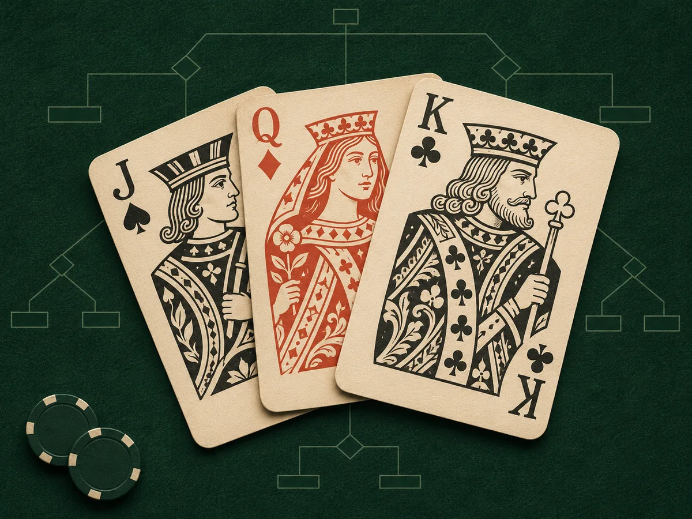

<section class="course-hero" id="start-here" aria-labelledby="learn-to-solve-poker" markdown="1">

An open-source poker curriculum

# Learn to solve poker.

Build poker solvers from first principles. Start with a three-card game, then work up to Hold’em, neural search, and open research problems.
{: .course-lede }

[Start Module 00 →](modules/00_prereqs.md){ .course-button .course-button--primary }
[Explore the labs](labs.md){ .course-button }
{: .course-actions }

{ width="1200" height="900" .course-hero__image }

</section>

<section class="course-section" id="curriculum" aria-labelledby="the-curriculum" markdown="1">

## The curriculum

Fifteen modules with worked examples, Python code, and interactive experiments.

<ul class="course-grid" markdown="block">
<li class="course-card" markdown="block">

Modules 00–02

### [Foundations](modules/00_prereqs.md)

Learn expected value and regret matching, then solve your first game with Kuhn poker.
</li>
<li class="course-card" markdown="block">

Modules 03–04

### [Small solvable games](modules/03_leduc.md)

Add public cards and chance events with Leduc, then scale CFR with sampling.
</li>
<li class="course-card" markdown="block">

Modules 05–07

### [Hold’em and abstraction](modules/05_limit_holdem.md)

Work with ranges, simplify game trees, and explore heads-up no-limit push/fold strategy.
</li>
<li class="course-card" markdown="block">

Modules 08–09

### [Neural solvers](modules/08_deep_cfr.md)

Approximate regrets with Deep CFR and combine learned values with depth-limited search.
</li>
<li class="course-card" markdown="block">

Modules 10–12

### [The research frontier](modules/10_plo.md)

Explore Pot-Limit Omaha, multiplayer games, and the tradeoffs of exploiting an opponent.
</li>
<li class="course-card" markdown="block">

Modules 13–14

### [Custom games and case studies](modules/13_variants.md)

Model a new poker variant and compare the techniques used by landmark poker bots.
</li>
</ul>

[See the full roadmap →](roadmap.md){ .course-text-link }

</section>

<section class="course-section course-solving" aria-labelledby="the-three-levels-of-solved" markdown="1">

## What does “solved” mean? { #the-three-levels-of-solved }

| Level | What we know | Examples |
| --- | --- | --- |
| **Solved** | An exact equilibrium is known or a strategy is provably near equilibrium. | Kuhn poker, Leduc, heads-up limit Hold’em (Cepheus) |
| **Practically strong** | The strategy beats top humans. An equilibrium guarantee remains open. | Heads-up no-limit (DeepStack, Libratus), six-player no-limit (Pluribus) |
| **Open** | Equilibria or exploitability are hard to compute. | Multiplayer equilibrium, full-scale Pot-Limit Omaha, novel variants |

</section>

